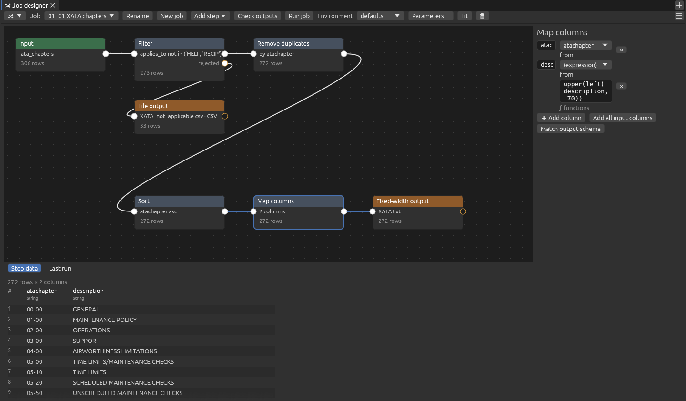
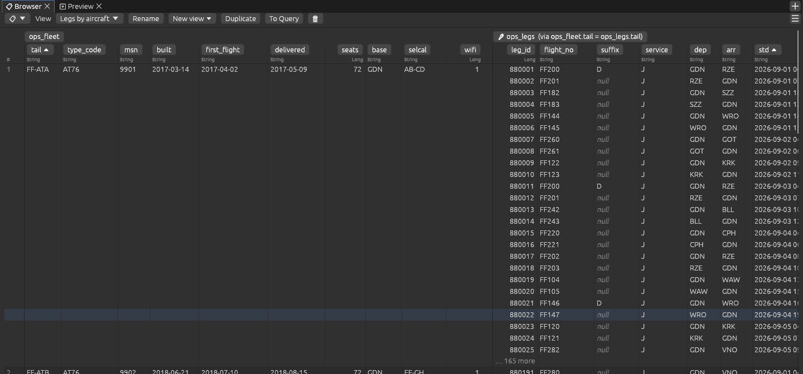
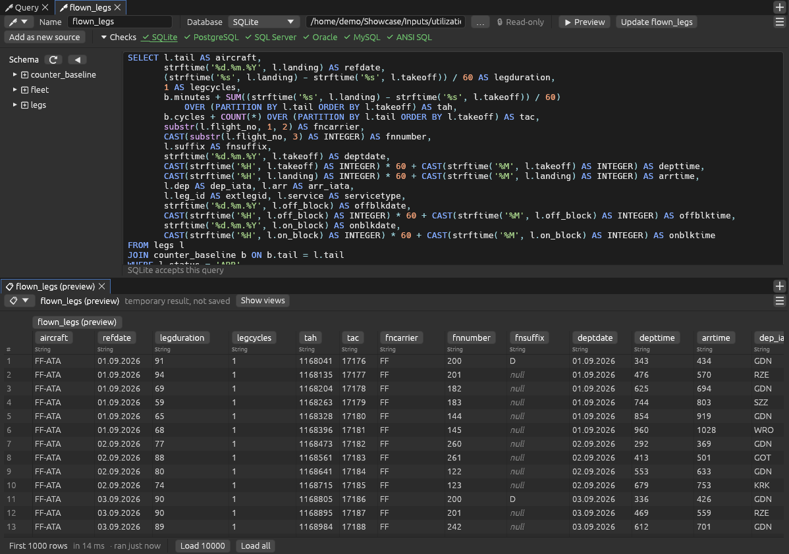

# dbdb

dbdb is an ETL and data migration tool written in pure Rust, with a desktop
interface built on [egui](https://github.com/emilk/egui). You point it at the
files and databases you have, look around in the data, design jobs that
reshape it, and get checked output files or database tables at the other
end.

It is one program with nothing else to install, it starts in a moment, and
everything runs on your own machine: no account, no server, nothing sent
anywhere.



**[Download the latest release](https://github.com/koziserek/dbdb/releases/latest)**
· [all releases](https://github.com/koziserek/dbdb/releases)
· [report a problem](https://github.com/koziserek/dbdb/issues)

This repository holds the releases of dbdb and its issues. dbdb is
shareware: free for individuals and small organisations, paid for larger
ones, and yours to pass on unchanged. Its source is not published. See
[Licence](#licence).

## What you get

dbdb comes in four shapes that share one engine and one project file:

- **`dbdb-app`**, the desktop designer.
- **`dbdb-cli`**, the command line: look into sources, check files, run jobs
  from a script or a scheduler.
- **The browser build**, the same app compiled to WebAssembly: a folder of
  static files for any web server.
- **An MCP server** (`dbdb-cli mcp`), so that an AI assistant can look at
  your data and drive a migration with the same commands the app uses.

## What it does

- **Reads from where the data is.** Excel and ODS sheets, CSV and other
  delimited text, JSON and JSON Lines, Parquet, fixed-width files laid out
  by a Talend/Talaxie schema, SQLite, PostgreSQL, SQL Server, MariaDB and
  MySQL, MS Access files without Access or a driver, and Oracle
  (experimental). Text files need not be UTF-8. A read never changes a
  database.
- **Browses joined data.** The Browser pane shows a source as a table and
  nests joined rows under each parent row, so you see a customer with its
  orders without writing a query. Joins are suggested from matching values
  and from declared relations.
- **Runs jobs you design.** A job is a canvas of steps joined by wires:
  filter, sort, remove duplicates, join, append, aggregate, map columns with
  expressions, and run other jobs. Every step shows its row count and its
  rows, so you see what each step did to the data.
- **Checks before it writes.** Duplicate keys, missing mandatory values,
  values too long for their column, formats that do not match, and fields
  that must or must not be filled depending on another field. Rows the
  checks object to can go to a file of their own, with the row number and
  the reason.
- **Writes files and loads databases.** Fixed-width files, CSV, JSON, Excel,
  Parquet and SQLite, and PostgreSQL, SQL Server and SQLite tables. A database load
  is one transaction, so it is all or nothing, and a dry run goes through
  the whole write and takes it back.
- **Brings a Talaxie project along.** It imports a Talaxie or Talend Open
  Studio project folder: connections, file definitions, the common
  components and context variables, with a report of what was converted and
  what was not. dbdb is inspired by Talaxie and shares no code with it.
- **Helps with SQL.** The Query pane checks a query as you type, points out
  what another database would reject, and previews the first rows.
- **Works with an AI assistant.** `dbdb-cli guide` prints everything an
  assistant needs to build a project from your inputs, and `dbdb-cli mcp`
  offers the same over the Model Context Protocol.





## Download

Each [release](https://github.com/koziserek/dbdb/releases/latest) has one
archive for each system:

| File | For |
| --- | --- |
| `dbdb-<version>-linux-x86_64.tar.xz` | Linux, x86_64 |
| `dbdb-<version>-windows-x86_64.zip` | Windows, x86_64 |
| `dbdb-<version>-macos-arm64.tar.xz` | macOS, Apple Silicon |
| `dbdb-<version>-wasm32.zip` | the app for a web browser, on any system |
| `SHA256SUMS` | checksums of the files above |

The "Source code" archives that GitHub adds to every release hold only this
page, the licence and the pictures.

To check a download against its checksum:

```sh
sha256sum -c SHA256SUMS --ignore-missing    # Linux
shasum -a 256 -c SHA256SUMS --ignore-missing  # macOS
```

The desktop archives each hold `dbdb-app`, the desktop designer, and
`dbdb-cli`, with a README that describes every feature. Unpack one and run
the app; there is nothing else to install.

### Linux

```sh
tar -xf dbdb-*-linux-x86_64.tar.xz
cd dbdb-*-linux-x86_64
./dbdb-app
```

The programs run on other distributions too, also older ones (glibc 2.31
and newer). A Wayland desktop such as GNOME or KDE shows the app's icon only
once it has a menu entry; the archive brings a script that adds one for your
user:

```sh
./install-desktop.sh            # run again after moving the folder
./install-desktop.sh --remove   # take it away again
```

### Windows

Unpack the zip and start `dbdb-app.exe`. The programs are not signed, so
Windows may warn about an unknown publisher the first time: choose "More
info", then "Run anyway".

### macOS

The archive is for Apple Silicon and holds `dbdb.app` and `dbdb-cli`. Drag
`dbdb.app` into Applications and start it like any other app, also from
Spotlight.

dbdb is not signed with an Apple Developer ID, so macOS blocks a downloaded
copy the first time. Clear the download flag once:

```sh
xattr -dr com.apple.quarantine /Applications/dbdb.app
```

or try to open it, dismiss the warning, and allow it under System Settings >
Privacy & Security > Open Anyway. Do the same for `dbdb-cli` if you use it:
`xattr -d com.apple.quarantine dbdb-cli`.

### In a web browser

`dbdb-<version>-wasm32.zip` is the app as a folder of static files. Put it
on any web server (it does not start from a `file://` address), for example:

```sh
unzip dbdb-*-wasm32.zip && python3 -m http.server -d dbdb-*-wasm32
```

Files are read inside the page and nothing is uploaded. Database servers are
reached through a small WebSocket proxy that you run yourself; the app shows
the command for it. The README in the archive has the details.

## Problems and wishes

Open an [issue](https://github.com/koziserek/dbdb/issues) and say which
version and system you use, what you did and what happened. Leave real
data, passwords and connection strings out: an issue is public.

`dbdb-cli --version` prints the version, and the app shows it under Help >
Licences….

## Licence

dbdb is shareware, as in the old days: try it, pass it on, and pay when
you are big enough. It is proprietary software and its source is not
published. Its use is governed by the dbdb Licence in [LICENSE](LICENSE),
which is still a draft:

- **Free:** for individuals, and for organisations with no more than 10
  people and no more than 5 million Swiss francs of yearly revenue.
- **Paid:** larger organisations need a commercial licence after 30 days of
  evaluation, and so does work done for them by consultants. To ask for
  one, open an issue here.
- **Share it:** you may give anyone a complete, unchanged copy, free of
  charge and with its licence. Selling it, changing it, offering it as a
  service or reverse engineering it needs permission.

What you make with dbdb is yours.

And in the tradition of shareware: if you like dbdb, you "shall" praise it
and pass it on. If you do not, you are "obliged" to say what is wrong, in an
[issue](https://github.com/koziserek/dbdb/issues). Neither is a condition
of the licence, and both are meant.

The programs carry the licence and the list of the components by other
authors they are built from, each with its licence: Help > Licences… in the
app, and `dbdb-cli licences` on the command line.
